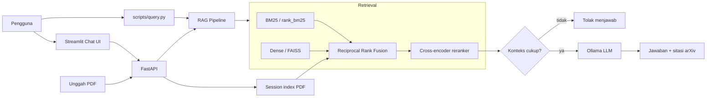

# arXiv RAG Assistant

Domain-specific Retrieval-Augmented Generation assistant for AI, machine learning, and NLP papers.

## English summary

This project is a portfolio-quality RAG assistant over a sample of arXiv papers in `cs.AI`, `cs.CL`, and `cs.LG`. Metadata comes from the public [Kaggle arXiv Dataset](https://www.kaggle.com/datasets/Cornell-University/arxiv) (Cornell University). Each paper's title and abstract are chunked, embedded with `BAAI/bge-small-en-v1.5`, and indexed in FAISS together with a BM25 index (`rank_bm25`). Queries are answered by a hybrid retriever (BM25 + dense, fused with Reciprocal Rank Fusion) followed by a cross-encoder reranker (`cross-encoder/ms-marco-MiniLM-L-6-v2`). A local open-source LLM served by Ollama (default `llama3.1:8b`, alternative `qwen2.5:7b`) generates answers with `[arXiv id]` citations that link to `https://arxiv.org/abs/<id>`, and refuses when the retrieved context is too weak. Users can also upload a PDF; its full text is chunked into a separate session index and can be searched on its own or together with the arXiv collection. The stack is FastAPI + Streamlit, with a retrieval evaluation (Recall@k, MRR) comparing BM25, dense, hybrid, and hybrid+rerank. The raw dataset is **not** included in this repository.

---

## Masalah

Asisten tanya-jawab umum sering **mengarang** sitasi dan mencampur pengetahuan umum dengan isi paper. Untuk portofolio dan riset, yang dibutuhkan adalah asisten yang:

- hanya menjawab dari konteks paper yang berhasil di-retrieve,
- mencantumkan sitasi ke identifikasi arXiv yang bisa diklik,
- bisa disaring menurut tahun dan kategori,
- dievaluasi secara terukur, bukan hanya demo chat.

Project ini membangun pipeline RAG khusus domain AI/ML & NLP untuk kebutuhan itu.

## Dataset

- Sumber: [arXiv Dataset](https://www.kaggle.com/datasets/Cornell-University/arxiv) di Kaggle (Cornell University), file `arxiv-metadata-oai-snapshot.json`.
- Filter kategori: `cs.AI`, `cs.CL`, `cs.LG`.
- Snapshot yang dipindai saat pembangunan index (angka terukur): **3.252.452** rekaman mentah, **488.660** paper lolos filter kategori, lalu reservoir sample **10.000** paper (seed 42) yang menghasilkan **12.471** chunk.
- Sebaran multi-label pada seluruh paper yang lolos filter (satu paper bisa masuk lebih dari satu kategori): `cs.LG` 299.024, `cs.AI` 212.730, `cs.CL` 125.322. Tahun pada sampel yang diindeks: 1994–2026. Rincian ada di `reports/ingest_stats.json`.
- Yang diindeks adalah **judul + abstrak** (snapshot Kaggle tidak berisi full text). Full text didukung lewat fitur unggah PDF pengguna.
- Dataset mentah **tidak disertakan** di repositori ini (ukuran beberapa GB dan mengikuti ketentuan Kaggle). Pengguna mengunduhnya sendiri; lihat langkah setup di bawah.

## Arsitektur



Alur singkat: pertanyaan → BM25 dan dense retrieval (bisa dengan filter tahun/kategori) → fusi RRF → rerank → jika skor terbaik di bawah ambang, sistem menolak menjawab → jika cukup, LLM menghasilkan jawaban yang wajib menyertakan sitasi `[id]`.

## Fitur

- **Hybrid search + reranker**: BM25 + embedding padat, digabung dengan Reciprocal Rank Fusion, lalu di-rerank oleh cross-encoder.
- **Evaluasi terukur**: dataset eval sintetis (known-item retrieval dengan `gold_arxiv_id`), metrik Recall@k dan MRR untuk BM25 vs dense vs hybrid vs hybrid+rerank. Evaluasi faithfulness / relevansi jawaban bersifat opsional (LLM-as-judge lewat Ollama, atau RAGAS jika Anda ingin menambahkannya sendiri).
- **Jawaban bersitasi**: kutipan berbentuk `[1706.03762]` yang mengarah ke `https://arxiv.org/abs/1706.03762`. Jika konteks tidak cukup, asisten menolak menjawab.
- **Filter metadata**: tahun (`year_min`, `year_max`) dan kategori (`cs.AI` / `cs.CL` / `cs.LG`).
- **Unggah PDF**: teks diekstrak (`pypdf`), di-chunk dengan overlap, dan diindeks ke koleksi sesi terpisah. Query bisa ke arXiv saja, PDF saja, atau keduanya.

Fitur ringkasan/perbandingan multi-paper **sengaja tidak disertakan**.

## Setup

### 1. Python

Python 3.10+ (disarankan 3.11). Di mesin tanpa GPU, pasang PyTorch CPU terlebih dahulu:

```bash
python -m venv .venv
source .venv/bin/activate   # Windows: .venv\Scripts\activate
pip install torch --index-url https://download.pytorch.org/whl/cpu
pip install -e ".[dev]"
```

Atau: `pip install -r requirements.txt`.

### 2. Ollama (LLM lokal, gratis)

1. Instal [Ollama](https://ollama.com/download) untuk sistem Anda, lalu pastikan server berjalan (`ollama serve` jika belum otomatis).
2. Unduh model default (cocok untuk RAM 16 GB):

```bash
ollama pull llama3.1:8b
```

Alternatif yang didokumentasikan: `ollama pull qwen2.5:7b`. Model bisa diganti di `configs/config.yaml` (`llm.model`) atau lewat variabel lingkungan `OLLAMA_MODEL`. URL server bisa diubah lewat `OLLAMA_BASE_URL` (default `http://localhost:11434`).

Tanpa Ollama, retrieval dan evaluasi Recall@k / MRR tetap bisa dijalankan (`python scripts/query.py --retrieve-only "..."`). Generasi jawaban membutuhkan Ollama.

### 3. Unduh data

Perlu akun Kaggle dan file kredensial (`~/.kaggle/kaggle.json`), atau cache `kagglehub` yang sudah ada.

```bash
python scripts/download_data.py
```

Skrip ini memeriksa `~/.cache/kagglehub` terlebih dahulu, lalu baru mengunduh [Cornell-University/arxiv](https://www.kaggle.com/datasets/Cornell-University/arxiv) jika belum ada, dan menautkannya ke `data/raw/arxiv-metadata-oai-snapshot.json`.

### 4. Bangun index

```bash
python scripts/build_index.py
```

Langkah ini memfilter kategori, mengambil sampel (default 10.000), membuat chunk, menghitung embedding, lalu menulis FAISS + BM25 ke `indexes/`. Unduhan pertama model embedding (~130 MB) memerlukan koneksi internet. Ubah jumlah paper dengan `--sample-size 10000` atau `data.sample_size` di YAML.

### 5. Jalankan API dan UI

Terminal 1:

```bash
uvicorn arxiv_rag.api:app --host 0.0.0.0 --port 8000
```

Terminal 2:

```bash
streamlit run app/streamlit_app.py
```

UI default memakai `http://localhost:8000`. Endpoint API:

- `GET /health`
- `POST /query` — body JSON: `question`, filter opsional `year_min`, `year_max`, `category`, plus `session_id` dan `source` (`arxiv` | `pdf` | `both`)
- `POST /upload-pdf` — `multipart/form-data` field `file`

Query lewat CLI:

```bash
python scripts/query.py "What is the Transformer architecture?" --retrieve-only
python scripts/query.py "What is the Transformer architecture?" --category cs.CL --year-min 2017
```

### 6. Evaluasi

```bash
python scripts/evaluate.py
```

Untuk menambahkan penilaian faithfulness / relevansi oleh LLM lokal (opsional, butuh Ollama):

```bash
python scripts/evaluate.py --with-llm --llm-n 10
```

Hasil ditulis ke `reports/retrieval_metrics.json` dan `reports/eval_questions.json`.

EDA ada di `notebooks/01_eda.ipynb`.

### Docker (opsional)

Setelah data dan index tersedia di `./data` dan `./indexes`:

```bash
docker compose up --build
```

Service: `ollama` (port 11434), `api` (8000), `ui` (8501). Model Ollama tetap perlu di-pull, misalnya:

```bash
docker compose exec ollama ollama pull llama3.1:8b
```

## Hasil evaluasi retrieval

Evaluasi known-item: setiap pertanyaan dibuat dari satu kalimat khas di abstrak paper, dengan `gold_arxiv_id` yang diketahui. Metode yang dibandingkan memakai corpus dan pertanyaan yang sama.

<!-- METRICS:START -->
Angka berikut diukur pada index 10.000 paper / 12.471 chunk, 100 pertanyaan known-item (setiap query adalah satu kalimat dari abstrak paper, dengan `gold_arxiv_id` yang diketahui). Model embedding: `BAAI/bge-small-en-v1.5`. Reranker: `cross-encoder/ms-marco-MiniLM-L-6-v2`. File lengkap: `reports/retrieval_metrics_summary.json` dan `reports/retrieval_metrics.json`.

| Metode | Recall@1 | Recall@5 | Recall@10 | MRR |
| --- | --- | --- | --- | --- |
| BM25 | 1.000 | 1.000 | 1.000 | 1.000 |
| Dense (`bge-small-en-v1.5`) | 0.620 | 0.740 | 0.780 | 0.673 |
| Hybrid (RRF) | 0.790 | 0.970 | 1.000 | 0.863 |
| Hybrid + rerank | 0.970 | 1.000 | 1.000 | 0.983 |

- Jumlah pertanyaan eval: 100
- Jumlah chunk di index: 12.471
- Faithfulness / answer relevance (LLM-as-judge, opsional): tidak dijalankan — Ollama tidak tersedia di lingkungan pembangunan project ini. Jalankan `python scripts/evaluate.py --with-llm` di mesin Anda setelah `ollama pull llama3.1:8b`.

**Cara membaca tabel ini.** Skor BM25 yang sempurna diharapkan pada set eval ini: pertanyaannya adalah kutipan yang hampir identik dengan abstrak sumber, jadi kecocokan leksikal sangat tinggi. Itu bias yang diketahui dari evaluasi known-item sintetis, bukan bukti bahwa BM25 selalu unggul di pertanyaan pengguna nyata. Dense retrieval lebih lemah (banyak query panjang/berisi istilah yang tersebar). Hybrid murni (RRF) menurunkan Recall@1 dibanding BM25 karena peringkat dense dapat menggeser dokumen emas dari posisi pertama, tetapi setelah cross-encoder rerank, Recall@1 naik ke 0,97 dan MRR ke 0,983 — reranker mengembalikan dokumen emas ke peringkat atas. Inilah alasan pipeline produksi memakai **hybrid + rerank**, bukan BM25 saja.
<!-- METRICS:END -->

Angka di tabel ini **tidak pernah dikarang**. Ulangi `python scripts/evaluate.py` di mesin Anda untuk mereproduksi atau menyesuaikan sampel.

## Keterbatasan

- Index default hanya berisi judul dan abstrak, bukan isi lengkap paper arXiv. Detail metode, bukti, dan rumus yang hanya ada di badan paper tidak dapat di-retrieve kecuali Anda mengunggah PDF-nya.
- Jawaban bergantung pada kualitas retrieval dan pada model Ollama 7–8B; model ini bisa saja merangkum terlalu bebas meskipun prompt sudah menuntut sitasi.
- Filter tahun/kategori diterapkan sebagai post-filter pada kandidat; pada kombinasi filter yang sangat sempit, hasil bisa kosong.
- Sesi PDF disimpan di memori proses API (file fisik ada di `uploads/`) dan hilang saat server di-restart; unggah ulang jika perlu.
- Evaluasi retrieval bersifat known-item dan sintetis (kalimat dari abstrak), bukan pertanyaan pengguna nyata. Skor faithfulness opsional memakai LLM-as-judge, bukan anotator manusia.
- Project ini **bukan** alat saran medis, hukum, atau keputusan produksi; selalu periksa paper aslinya.

## Struktur project

```text
configs/config.yaml          # semua hyperparameter
src/arxiv_rag/               # paket Python modular
  data/                      # loader, chunking, parser PDF
  retrievers/                # BM25, dense, hybrid / RRF
  pipeline.py, api.py, ...
scripts/                     # download_data, build_index, query, evaluate
app/streamlit_app.py         # UI chat
notebooks/01_eda.ipynb
tests/                       # pytest (chunking, BM25, RRF, PDF, pipeline, API)
reports/                     # hasil evaluasi
Dockerfile, docker-compose.yml
.github/workflows/ci.yml     # ruff + pytest (tanpa unduh model)
```

## Lisensi

Kode dalam repositori ini dirilis di bawah lisensi [MIT](LICENSE). Metadata arXiv dan dataset Kaggle tetap mengikuti lisensi/ketentuan masing-masing; dataset **tidak** dibundel di sini.
